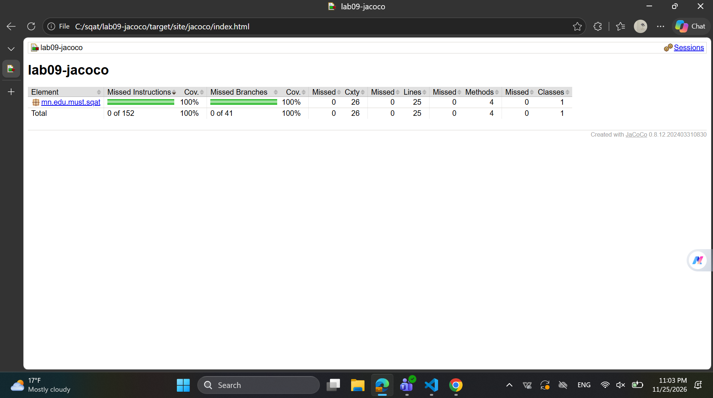
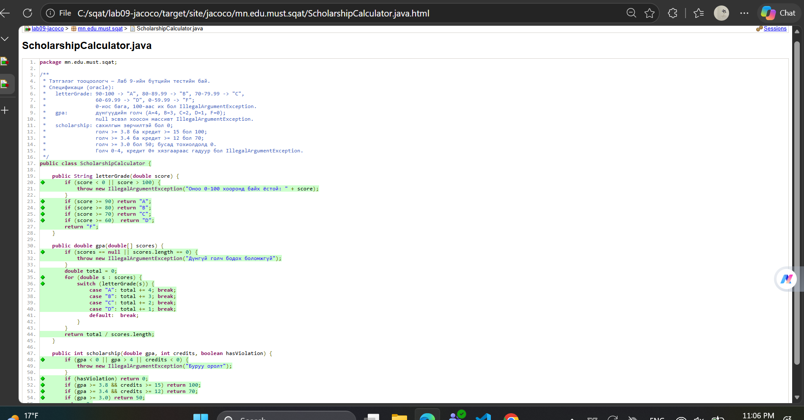
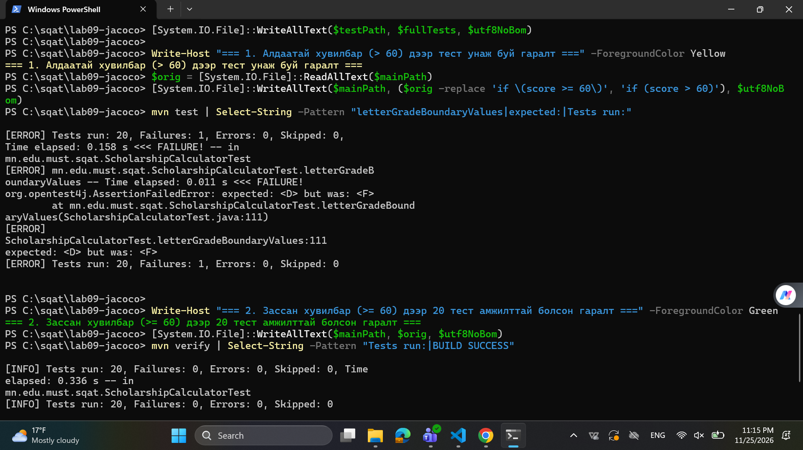

# Лаборатори 9 — JaCoCo код хамралт

- **Нэр:** А. Наранзул
- **Оюутны код:** B222270823
- **Хичээл:** Программ хангамжийн чанарын баталгаа ба туршилт (`F.CSA313`)

## Орчин

- **Үйлдлийн систем:** Windows 11
- **Java хувилбар:** JDK 17
- **Build болон хамралтын хэрэгсэл:** Apache Maven 3.9.16, JaCoCo (`mvn verify`)

## Төслийн бүтэц

- `src/main/java/mn/edu/must/sqat/ScholarshipCalculator.java` — Тэтгэлэг болон үсгэн үнэлгээ тооцоолох үндсэн класс
- `src/test/java/mn/edu/must/sqat/ScholarshipCalculatorTest.java` — JUnit 5 нэгж болон хязгаарын утгын тестүүд (20 тест)
- `results/` — Хэсэг A, B, C, D болон эцсийн үе шатны Maven ба JaCoCo CSV тайлангууд
- `screenshots/` — JaCoCo тайлан болон хязгаарын тестийн үр дүнгийн дэлгэцийн зургууд

## A — Happy path тест

Эхний хэвийн урсгалын тестүүдээ ажиллуулж, анхны JaCoCo тайланг (`results/jacoco-A.csv`, `results/mvn-verify-A.txt`) гарган авлаа. Тайлангаас ямар мөрүүд бүрэн ажиллаагүй болон аль нөхцөлүүдийн зөвхөн нэг талын салаа шалгагдсан нь тодорхой харагдсан.

## B — CFG ба бүрхэвч нэмэгдүүлэх

Оролтын зөв биш утгын шалгалт, үсгэн үнэлгээний боломжит утгууд, `switch`-ийн нөхцөлүүд болон `scholarship()` доторх давхар/богино холболттой логик салаануудыг бүрэн хамарсан тестүүд нэмж (`results/jacoco-B.csv`, `results/mvn-verify-B.txt`), кодын урсгалын замыг бүрэн шалгалаа.

## C — Давталтын зааг

Давталт хэдэн удаа давтагдаж байгаа болон оролтын цуглуулгын хэмжээний зааг тохиолдлуудыг (`results/jacoco-C.csv`, `results/mvn-verify-C.txt`) тусад нь шалгалаа. Бүрхэвчийн үзүүлэлт өндөр байсан ч давталт болон оролтын хязгаарын цэг тус бүрийг тусгай тестээр нягтлах нь найдвартай ажиллагаанд чухал байна.

## D — Зааг утгын алдаа

`letterGrade` функцийн заагийн цэгийг шалгах тест нэмэхэд `score > 60` нөхцөлөөс болж яг 60 оноог `F` үнэлгээ рүү оруулж байсан согог илэрч тест унасан (`results/mvn-test-D-fail.txt`). Нөхцөлийг `score >= 60` болгон зассаны дараа бүх 20 тест амжилттай давж, `results/jacoco-final.csv` болон `results/mvn-verify-final.txt` тайлангаар кодын бүрхэвч 100% болсон.

`score > 60` болон `score >= 60` нь хоёулаа үнэн/худал гэсэн хоёр салаа үүсгэдэг тул зөвхөн салааны хамралтыг харахад заагийн яг утга дээрх алдаа илрэлгүй өнгөрөх эрсдэлтэй. Тиймээс бүрхэвчийн хэмжүүрийг зааг утгын тест болон зөв хүлээгдэх үр дүнтэй хослуулан ашиглах нь зүйтэй.

## Дэлгэцийн зургууд

### Хэсэг A — Анхны JaCoCo тайлан

### 100% Бүрхэвчийн JaCoCo тайлан

### Зааг утгын тест ба засвар

## Дүгнэлт

`ScholarshipCalculator` төсөл дээр JaCoCo ашиглан мөр болон салааны хамралтыг үе шаттайгаар нэмэгдүүлж 100% бүрхэвчид хүргэн, хязгаарын утгын (`score > 60` vs `score >= 60`) бодит алдааг илрүүлж заслаа. Туршилтаар 100% branch хамралттай байсан ч заагийн цэг болон давталтын зааг тохиолдлуудыг тусгайлан шалгахгүй бол логик алдаа үлдэж болохыг харуулсан тул хамралтын тайланг зааг утгын тесттэй хамт ашиглах нь чанарын баталгааны чухал алхам юм.

## AI ашиглалт

Даалгаврын шаардлагыг ойлгох, тестүүдийн хувилбарыг төлөвлөх, тайлангийн агуулгыг цэгцлэхэд AI туслах хэрэгсэл ашигласан.
